# php-quickjs

Run untrusted **JavaScript or TypeScript inside PHP** — safely, with a typed,
bidirectional bridge.

`php-quickjs` embeds the [QuickJS-NG](https://github.com/quickjs-ng/quickjs) engine
directly in your PHP process. Guest code runs in an isolated context with memory,
time, and stack limits; PHP exposes a controlled allowlist of capabilities into JS;
and values, functions, and errors cross the boundary both ways. Guest code may be
TypeScript — it's transpiled in-process and runtime errors map back to the original
TS source. Pass `typescript: false` to `eval()` for JavaScript that should run
directly without transpilation.

Since 0.1.0, each runtime and its TypeScript compiler run on a dedicated native
thread. PHP callbacks, objects and closures remain on the PHP thread. With
Revolt autoloaded, waiting suspends the calling Fiber rather than the PHP thread.
Synchronous `php.*` callbacks and `Js\Callback` keep their existing API, including
nested calls.
JavaScript always executes on its dedicated worker, including callbacks invoked
from PHP. A synchronous PHP host call pauses its calling JS frame; the worker
can continue processing ready jobs and nested callback requests while PHP runs.
Call `$js->close()` to interrupt JS, join its worker and release PHP capabilities.
Close live runtimes before `fork()` and create new runtimes in the child; inherited runtimes reject entries in the child.

Built in Rust with [`ext-php-rs`](https://github.com/davidcole1340/ext-php-rs) and
[`rquickjs`](https://github.com/DelSkayn/rquickjs). QuickJS-NG is bundled — no system
library required.

## Features

- **Isolated guest** — memory, time, and stack limits contain runaway code.
- **Capability allowlist** — JS only sees the PHP functions you expose, as a frozen
  `php.module.fn()` SDK.
- **Bidirectional** — JS calls back into PHP, functions pass both ways, and opaque
  handles wrap live PHP objects.
- **TypeScript built in** — transpiled with [`oxc`](https://github.com/oxc-project/oxc);
  errors map to the original TS line and column.
- **Typed exceptions** — guest failures surface as `QuickJSEvalException` with a
  JS-like message and stack.

## Quick example

PHP exposes a narrow capability surface; the guest — JavaScript or TypeScript — runs
sandboxed and calls back in.

```php
<?php
$js = new QuickJS(memoryLimit: 32 * 1024 * 1024, timeoutMs: 500);
$js->register('fetchUser', fn(int $id) => ['name' => 'Ada', 'roles' => ['admin', 'dev']]);

echo $js->eval(<<<'TS'
    interface User { name: string; roles: string[] }   // types erase in-process
    const u: User = php.fetchUser(42);                  // re-enters PHP
    `${u.name} has ${u.roles.length} roles`;
TS);
// => "Ada has 2 roles"
```

A tour of the rest of the bridge:

```php
// Functions cross both ways — a JS callback arrives in PHP as a Js\Callback.
$js->register('map', fn(array $xs, callable $fn) => array_map($fn, $xs));
$js->eval('php.map([1, 2, 3], (n: number) => n * n)');         // => [1, 4, 9]

// Live objects stay host-side; JS only ever holds an opaque handle.
$h = $js->grant(new ArrayObject(['hits' => 0]));
$js->register('bump', fn(int $h) => ++$js->resolve($h)['hits']);
$js->eval("php.bump($h); php.bump($h);");                      // => 2

// Guest failures surface as typed exceptions, located in the original TS.
try {
    $js->eval("const x: any = null;\nx.field;");
} catch (QuickJSEvalException $e) {
    echo $e->getJsName(), ' @ line ', $e->getLine();          // => "TypeError @ line 2"
}

// Resource abuse is contained, and the engine recovers afterwards.
$g = new QuickJS(timeoutMs: 100);
try { $g->eval('while (true) {}'); } catch (QuickJSTimeoutException $e) {}
$g->eval('1 + 1');                                             // => 2
```

Run with `php -d extension=/path/to/libphp_quickjs.so script.php`. Fuller programs —
typed capabilities, `dts()`, isolated realms — in [`examples/`](examples):
`kitchen_sink.php`, `modes.php`, `usage.php`.

## Installation

Upstream [releases](https://github.com/eddmann/php-quickjs/releases) provide binaries
for PHP 8.4 / 8.5 on Linux, AWS Lambda and macOS (Apple Silicon). Those binaries may
not include the worker described here; build this fork at a worker revision when it is
required. Enable the binary matching your platform:

```ini
; php.ini
extension=/path/to/php-quickjs-...so
```

Or build from source (Rust 1.97+, clang, PHP dev headers — a plain cargo `cdylib`, no
`phpize`):

```sh
git clone https://github.com/xtrime-ru/php-quickjs && cd php-quickjs
# Check out a revision containing the worker before building.
make release
```

To build and test with PHP 8.5 + Rust 1.99.1 in Docker:

```sh
docker compose run --rm --build dev
```

The repository is mounted at `/workspace`; Cargo output stays in
`target/docker`, and dependency caches stay under `.cache/`.

→ Full platform matrix, Docker, and AWS Lambda / Bref instructions:
**[docs/install.md](docs/install.md)**.

## How it works

```mermaid
%%{init: {"theme":"base","themeCSS":".cluster-label text { fill:#c4c7c5 !important; } .edgeLabel .background { fill:#121212 !important; opacity:1 !important; }","htmlLabels":false,"markdownAutoWrap":false,"themeVariables":{"darkMode":true,"primaryTextColor":"#e6e1e5","textColor":"#e6e1e5","fontFamily":"system-ui, sans-serif","fontSize":"15px","lineColor":"#9aa0ab","edgeLabelBackground":"#121212","clusterBkg":"#1a1c20","clusterBorder":"#35383e"},"flowchart":{"htmlLabels":false,"curve":"linear","rankSpacing":45,"nodeSpacing":32}}}%%
flowchart TB
    subgraph Canvas[" "]
        direction TB
        subgraph PHP["PHP THREAD"]
            direction TB
            API("PHP API")
            Loop("Revolt event loop")
            Fiber("Waiting Fiber")
        end
        Cmd["Command queue"]
        subgraph Worker["QUICKJS WORKER THREAD"]
            direction TB
            Driver("Worker loop")
            Compiler("Oxc compiler")
            JS("QuickJS runtime")
            Jobs("Promise jobs")
            Driver -->|"TypeScript"| Compiler
            Compiler -->|"JavaScript"| JS
            Driver -->|"execute"| JS
            JS -->|"microtasks"| Jobs
        end
        Events["Event queue"]
        Messages["Message queue"]
        API -->|"eval · JS callback"| Cmd
        Cmd -->|"Request"| Driver
        JS -->|"Done · Messages"| Events
        Jobs -->|"Promise settled"| Events
        JS -->|"postMessage"| Messages
        Events -->|"native notification"| Loop
        Loop -->|"result / error"| Fiber
        Messages -->|"await / drain"| Fiber
    end
    style Canvas fill:#121212,stroke:#121212,stroke-width:80px,rx:12,ry:12
    style PHP fill:#171e2b,stroke:#486185,rx:8,ry:8
    style Worker fill:#1a1c20,stroke:#35383e,rx:8,ry:8
    classDef host fill:#1e293b,stroke:#486185,color:#dbeafe,stroke-width:1.5px
    classDef worker fill:#1c302c,stroke:#41685a,color:#d1fae5,stroke-width:1.5px
    classDef queue fill:#302b23,stroke:#786746,color:#fef3c7,stroke-width:1.5px
    class API,Loop,Fiber host
    class Driver,Compiler,JS,Jobs worker
    class Cmd,Events,Messages queue

```



1. PHP sends an evaluation, JS callback or PHP callback reply through the **command
   queue**. Only owned, typed values cross threads; PHP objects and closures remain
   on the PHP thread.
2. The worker executes JS and ready Promise jobs. Pending Promises stay associated
   with their request IDs. A synchronous PHP call pauses its JS frame while the
   worker can process ready jobs and nested JS callbacks.
3. Results, errors and PHP call requests travel through the **event queue**. A native
   readiness notification wakes Revolt, which resumes the appropriate waiting Fiber.
   Without Revolt, PHP waits synchronously. Synchronization uses no periodic polling.
4. `quickjs.postMessage()` writes snapshots to a separate, bounded **message queue**;
   PHP consumes them with `drainMessages()` or `awaitMessages()`.

Registered PHP capabilities go through one direct native entry point and a flat
dispatch table; the namespaced `php.*` tree is frozen JS built from your
registrations. The separate `quickjs.postMessage()` sink copies data into a
bounded native queue. Host calls, eval, saved callbacks and messages use native
conversion. Functions cross as registry references, and errors bridge both
ways with TS source locations.

→ **[docs/architecture.md](docs/architecture.md)** for the full design.

## Asynchronous execution

`eval()` and `Js\Callback` automatically await returned Promises. With Revolt
autoloaded, waits suspend the calling Fiber and worker notifications resume it;
rejections become PHP exceptions. Manual job APIs remain available for detached work. See
[asynchronous execution](docs/async.md).

Async consumers can send data-only notifications with `quickjs.postMessage(value)`
and read them using `QuickJS::drainMessages()`. The native queue snapshots values
at send time and has a configurable aggregate byte limit. `timeoutMs` remains an
optional wall-clock limit for a complete call, including Promise waits.

Resource budgets are separate: `memoryLimit` bounds the QuickJS heap, while
`maxQueuedMessageBytes` bounds retained native messages (32 MiB by default,
including accounting overhead). Native value conversion permits nesting up to
64 levels; it has no separate 16 MiB value limit. The TypeScript LRU cache defaults to
at most 256 entries and 32 MiB of source, generated JavaScript and source-map
strings. Set constructor arguments `transpileCacheMaxBytes` and
`transpileCacheMaxEntries` to customize these limits; both are non-negative, and
`0` in either disables caching. This cache budget does not bound temporary Oxc allocations. Direct
JavaScript evaluation with `typescript: false` bypasses Oxc and this cache.

## Scope

This is an *embedder*, not a standalone defence against hostile code. The capability
model contains *what JS can reach*; the resource limits contain *abuse* (infinite
loops, alloc bombs). QuickJS C memory-corruption bugs are **not** contained — for
attacker-controlled code, nest the extension inside an outer microVM / gVisor boundary.

## Documentation

- [Installation](docs/install.md) — prebuilt binaries, Docker, AWS Lambda (Bref), and
  building from source.
- [API reference](docs/api.md) — the `QuickJS` class and every method.
- [Architecture](docs/architecture.md) — the bridge, marshaling, function passing, and
  security model.
- [Execution modes](docs/execution-modes.md) — shared vs. isolated realms and the
  callback lifecycle.
- [Errors](docs/errors.md) — typed exceptions, both-way bridging, and TypeScript
  remapping.

## Development

`make stubs` regenerates the canonical IDE declarations atomically; failed
generation leaves the previous file intact. The PHP test suite compares these
signatures against the loaded extension. Consumers such as puphpeteer copy this
file for static analysis and should keep their copy synchronized.

## License

MIT
